# 外部接続順ダイアグラム（動的トレース自動生成）

> **自動生成ドキュメント**: 本ドキュメントは `./gradlew generateExternalConnectionDiagrams` により動的トレースから自動生成されています。手動編集は行わないでください。

| エンドポイント | トランザクション | 外部接続順 |
|---|---|---|
| `POST /api/auth/register` | readWrite | Spanner.UserRepository.existsByUsername → Spanner.UserRepository.save → Email.POST /api/v1/emails |
| `POST /api/auth/login` | readOnly | Spanner.UserRepository.findByUsername |
| `PUT /api/settings` | readWrite | Spanner.UserSettingsRepository.save |
| `GET /api/settings` | readOnly | Spanner.UserSettingsRepository.findByUserId |
| `POST /api/todos` | readWrite | Spanner.IdempotencyRecordRepository.findByUserIdAndKey → Spanner.UserSettingsRepository.findByUserId → Spanner.TodoRepository.countByUserIdAndCompletedFalse → KMS.Encrypt → Spanner.TodoRepository.save → KMS.Decrypt → PubSub.publish(CREATED) → Spanner.IdempotencyRecordRepository.save |
| `POST /api/todos (idempotent replay)` | readWrite | Spanner.IdempotencyRecordRepository.findByUserIdAndKey |
| `GET /api/todos` | readOnly | Spanner.TodoRepository.findAllByUserId → KMS.Decrypt |
| `GET /api/todos/{id}` | readOnly | Spanner.TodoRepository.findById → KMS.Decrypt |
| `PUT /api/todos/{id}` | readWrite | Spanner.TodoRepository.findById → KMS.Encrypt → Spanner.TodoRepository.save → KMS.Decrypt → PubSub.publish(UPDATED) |
| `PATCH /api/todos/{id} (reopen)` | readWrite | Spanner.TodoRepository.findById → Spanner.UserSettingsRepository.findByUserId → Spanner.TodoRepository.countByUserIdAndCompletedFalse → KMS.Encrypt → Spanner.TodoRepository.save → KMS.Decrypt → PubSub.publish(UPDATED) |
| `GET /api/admin/stats` | readOnly | Spanner.UserRepository.count → Spanner.TodoRepository.count → Spanner.TodoRepository.countByCompleted |
| `GET /api/admin/users` | readOnly | Spanner.UserRepository.findAll |
| `DELETE /api/todos/{id}` | readWrite | Spanner.TodoRepository.findById → Spanner.TodoRepository.delete → PubSub.publish(DELETED) |

## POST /api/auth/register

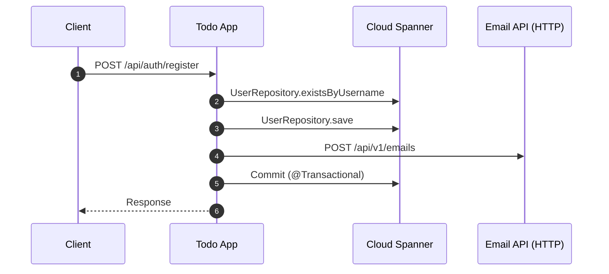

## POST /api/auth/login

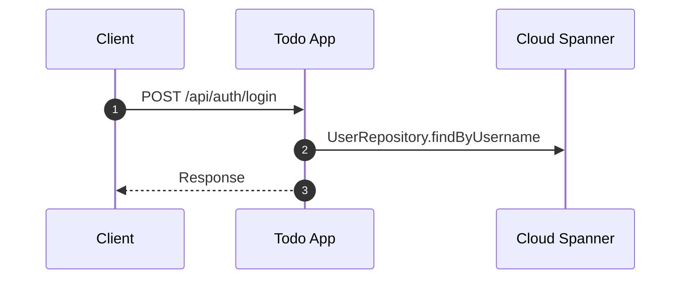

## PUT /api/settings

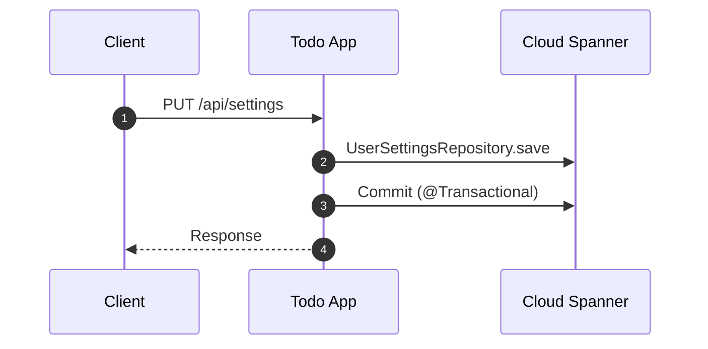

## GET /api/settings

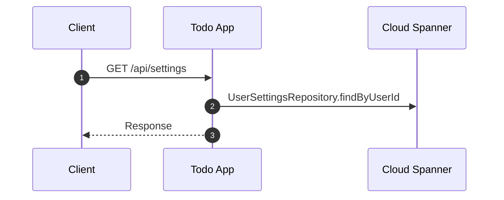

## POST /api/todos

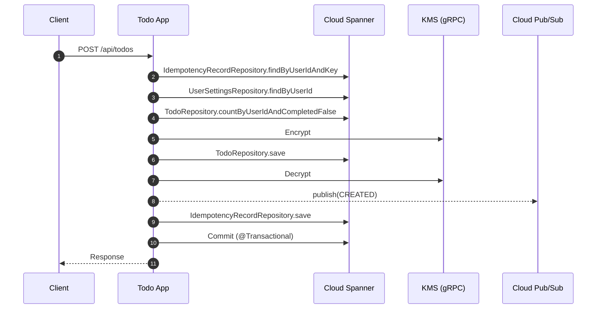

## POST /api/todos (idempotent replay)

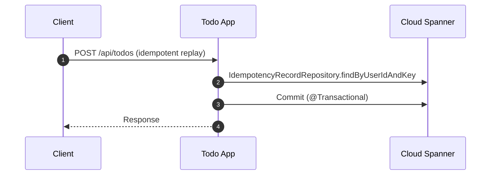

## GET /api/todos

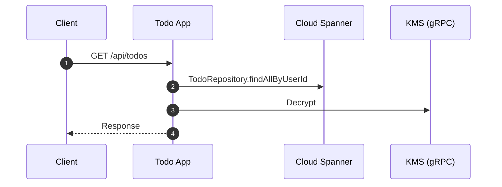

## GET /api/todos/{id}

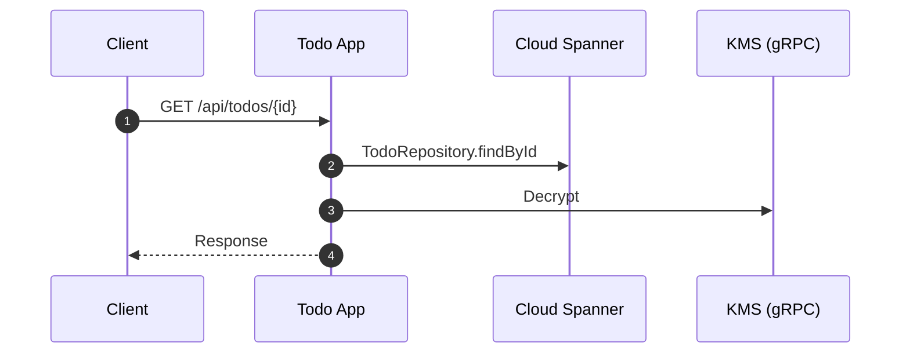

## PUT /api/todos/{id}

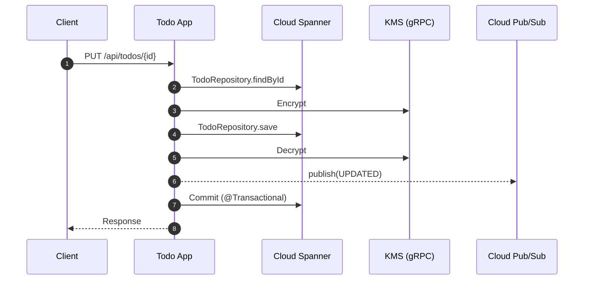

## PATCH /api/todos/{id} (reopen)

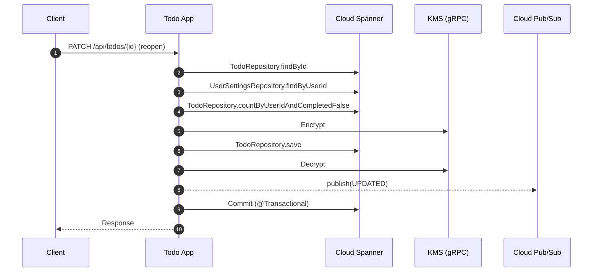

## GET /api/admin/stats

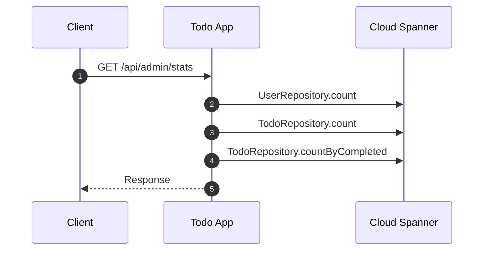

## GET /api/admin/users

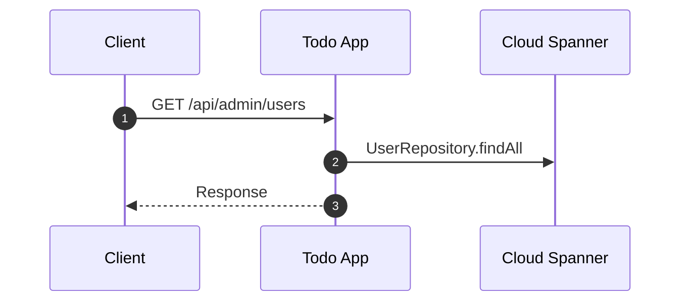

## DELETE /api/todos/{id}

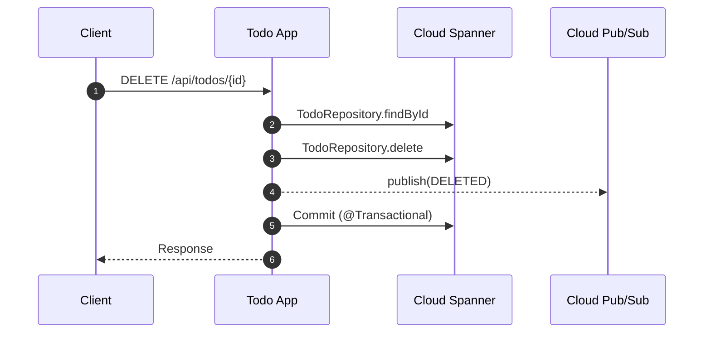

