# 外部接続順ダイアグラム（動的トレース自動生成）

> **自動生成ドキュメント**: 本ドキュメントは `./gradlew generateExternalConnectionDiagrams` により動的トレースから自動生成されています。手動編集は行わないでください。

| エンドポイント | トランザクション | 外部接続順 |
|---|---|---|
| `POST /api/auth/register` | readWrite | Spanner.UserRepository.existsByUsername → Spanner.UserRepository.save → Email.POST /api/v1/emails |
| `POST /api/auth/login` | readOnly | Spanner.UserRepository.findByUsername |
| `PUT /api/user/settings` | readWrite | Spanner.UserSettingsRepository.save |
| `GET /api/user/settings` | readOnly | Spanner.UserSettingsRepository.findByUserId |
| `POST /api/todos` | readWrite | Spanner.IdempotencyRecordRepository.findByUserIdAndKey → Spanner.UserSettingsRepository.findByUserId → Spanner.TodoRepository.countByUserIdAndCompletedFalse → KMS.Encrypt → Spanner.TodoRepository.save → KMS.Decrypt → PubSub.publish(CREATED) → Spanner.IdempotencyRecordRepository.save |
| `POST /api/todos (idempotent replay)` | readWrite | Spanner.IdempotencyRecordRepository.findByUserIdAndKey |
| `GET /api/todos` | readOnly | Spanner.TodoRepository.findAllByUserId → KMS.Decrypt |
| `GET /api/todos/{id}` | readOnly | Spanner.TodoRepository.findById → KMS.Decrypt |
| `PUT /api/todos/{id}` | readWrite | Spanner.TodoRepository.findById → KMS.Encrypt → Spanner.TodoRepository.save → KMS.Decrypt → PubSub.publish(UPDATED) |
| `PATCH /api/todos/{id} (reopen)` | readWrite | Spanner.TodoRepository.findById → Spanner.UserSettingsRepository.findByUserId → Spanner.TodoRepository.countByUserIdAndCompletedFalse → KMS.Encrypt → Spanner.TodoRepository.save → KMS.Decrypt → PubSub.publish(UPDATED) |
| `GET /api/admin/stats` | readOnly | Spanner.UserRepository.count → Spanner.TodoRepository.count → Spanner.TodoRepository.countByCompleted |
| `GET /api/admin/users` | readOnly | Spanner.UserRepository.findAll |
| `POST /api/todos/{id}/subtasks` | readWrite | Spanner.TodoRepository.findById → Spanner.TodoSubtaskRepository.findAllByTodoIdOrderByPositionAsc → Spanner.TodoSubtaskRepository.save |
| `GET /api/todos/{id}/subtasks` | readOnly | Spanner.TodoRepository.findById → Spanner.TodoSubtaskRepository.findAllByTodoIdOrderByPositionAsc |
| `PATCH /api/todos/{id}/subtasks/{subtaskId}` | readWrite | Spanner.TodoRepository.findById → Spanner.TodoSubtaskRepository.findById → Spanner.TodoSubtaskRepository.save |
| `DELETE /api/todos/{id}/subtasks/{subtaskId}` | readWrite | Spanner.TodoRepository.findById → Spanner.TodoSubtaskRepository.findById → Spanner.TodoSubtaskRepository.deleteById |
| `POST /api/todos/{id}/comments` | readWrite | Spanner.TodoRepository.findById → Spanner.TodoCommentRepository.save → Spanner.UserRepository.findById |
| `GET /api/todos/{id}/comments` | readOnly | Spanner.TodoRepository.findById → Spanner.TodoCommentRepository.findAllByTodoIdOrderByCreatedAtAsc → Spanner.UserRepository.findById |
| `DELETE /api/todos/{id}/comments/{commentId}` | readWrite | Spanner.TodoRepository.findById → Spanner.TodoCommentRepository.findById → Spanner.TodoCommentRepository.deleteById |
| `DELETE /api/todos/{id}` | readWrite | Spanner.TodoRepository.findById → Spanner.TodoRepository.delete → PubSub.publish(DELETED) |
| `POST /api/projects` | readWrite | Spanner.ProjectRepository.save → Spanner.ProjectMemberRepository.save |
| `GET /api/projects` | readOnly | Spanner.ProjectMemberRepository.findAllByUserId → Spanner.ProjectRepository.findAllByIdIn |
| `GET /api/projects/{projectId}` | readOnly | Spanner.ProjectMemberRepository.findByProjectIdAndUserId → Spanner.ProjectRepository.findById |
| `PUT /api/projects/{projectId}` | readWrite | Spanner.ProjectMemberRepository.findByProjectIdAndUserId → Spanner.ProjectRepository.findById → Spanner.ProjectRepository.save |
| `POST /api/projects/{projectId}/members` | readWrite | Spanner.ProjectMemberRepository.findByProjectIdAndUserId → Spanner.UserRepository.findByUsername → Spanner.ProjectMemberRepository.findByProjectIdAndUserId → Spanner.ProjectMemberRepository.save |
| `GET /api/projects/{projectId}/members` | readOnly | Spanner.ProjectMemberRepository.findByProjectIdAndUserId → Spanner.ProjectMemberRepository.findAllByProjectId → Spanner.UserRepository.findAllByIdIn |
| `DELETE /api/projects/{projectId}/members/{userId}` | readWrite | Spanner.ProjectMemberRepository.findByProjectIdAndUserId → Spanner.ProjectMemberRepository.findByProjectIdAndUserId → Spanner.ProjectMemberRepository.deleteByProjectIdAndUserId |
| `DELETE /api/projects/{projectId}` | readWrite | Spanner.ProjectMemberRepository.findByProjectIdAndUserId → Spanner.ProjectRepository.findById → Spanner.TodoRepository.deleteAllByProjectId → Spanner.ProjectMemberRepository.deleteAllByProjectId → Spanner.ProjectRepository.deleteById |

## POST /api/auth/register

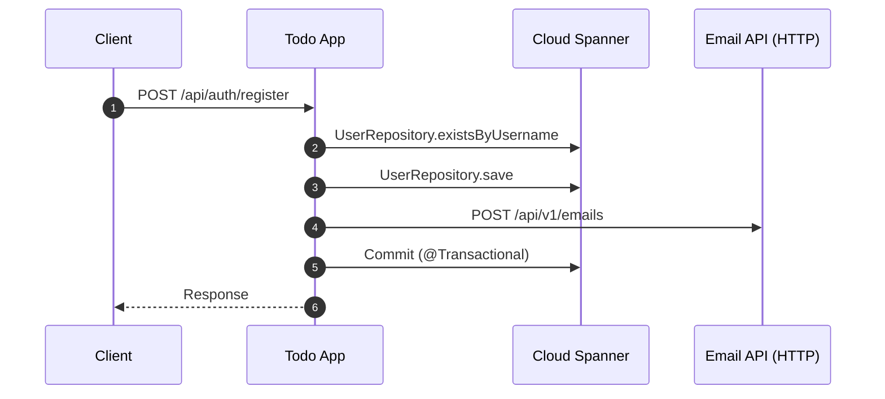

## POST /api/auth/login

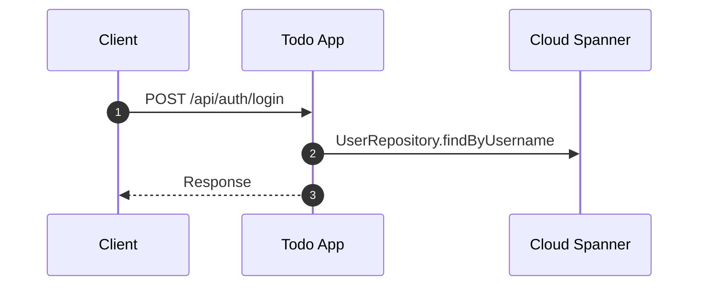

## PUT /api/user/settings


## GET /api/user/settings

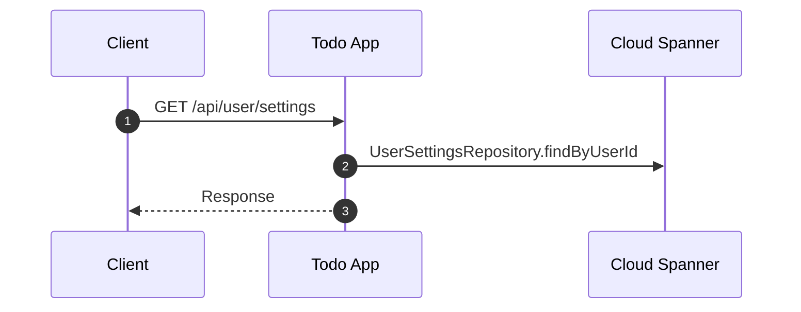

## POST /api/todos

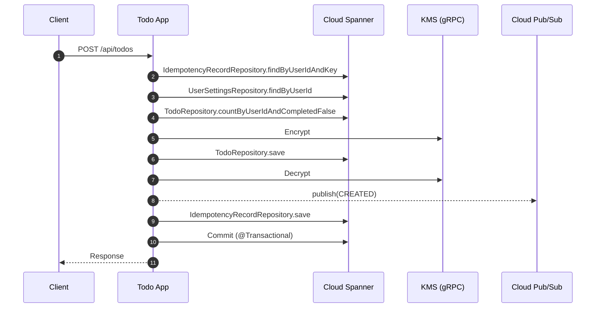

## POST /api/todos (idempotent replay)

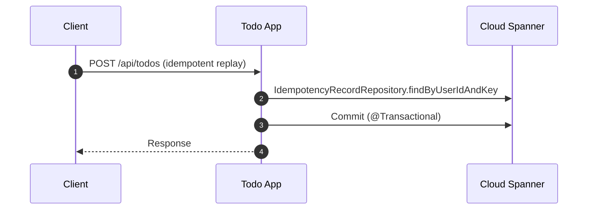

## GET /api/todos

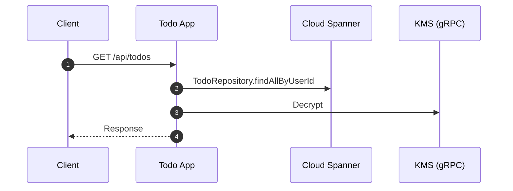

## GET /api/todos/{id}

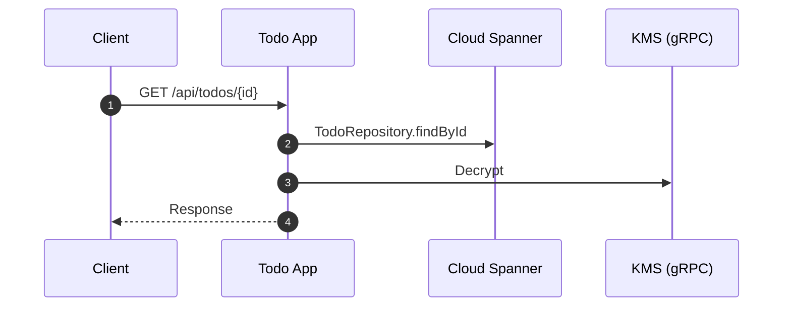

## PUT /api/todos/{id}

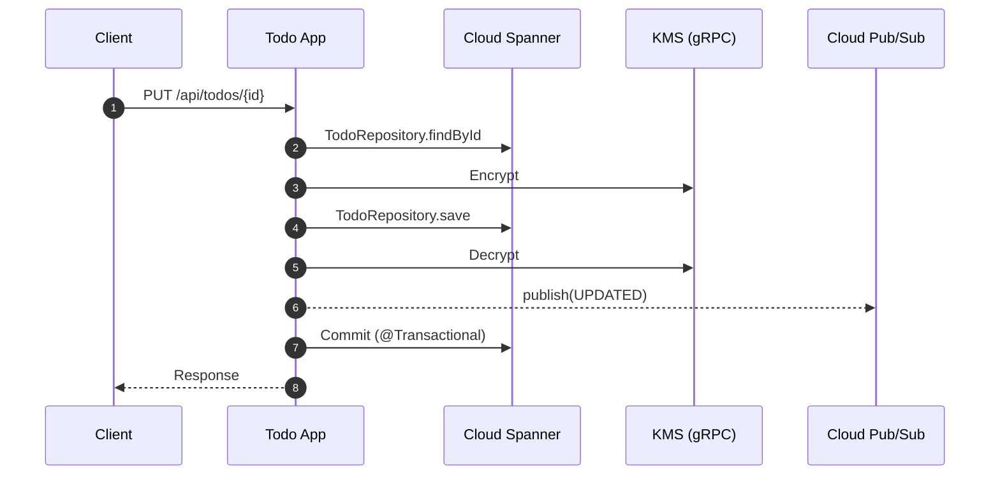

## PATCH /api/todos/{id} (reopen)

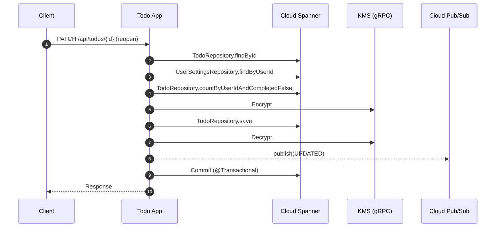

## GET /api/admin/stats

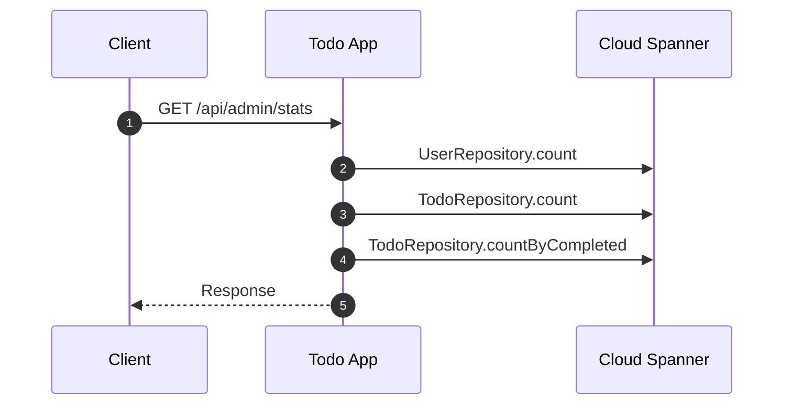

## GET /api/admin/users

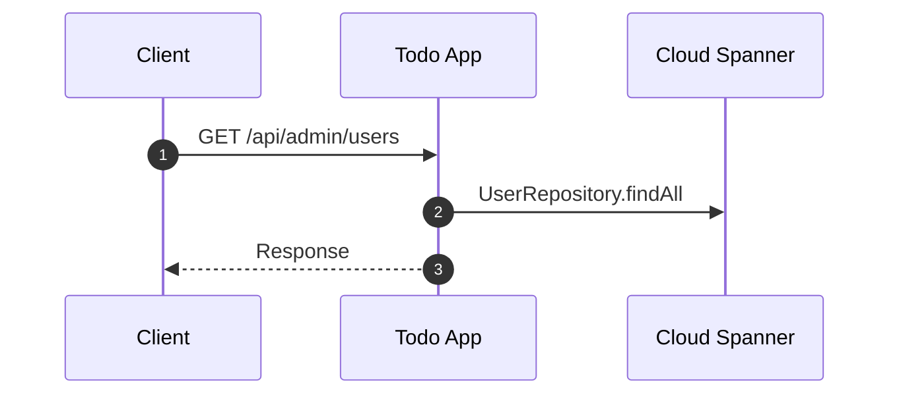

## POST /api/todos/{id}/subtasks

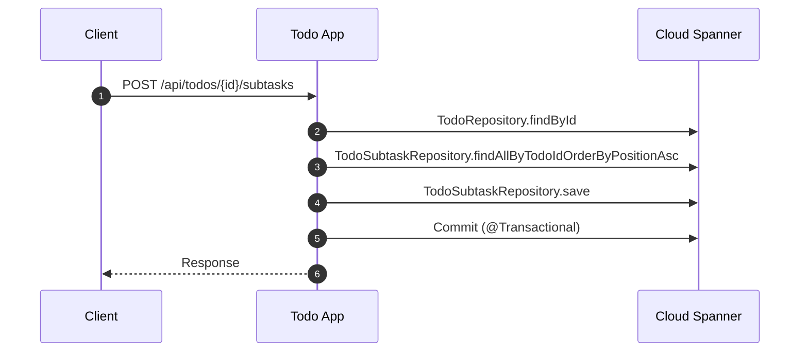

## GET /api/todos/{id}/subtasks

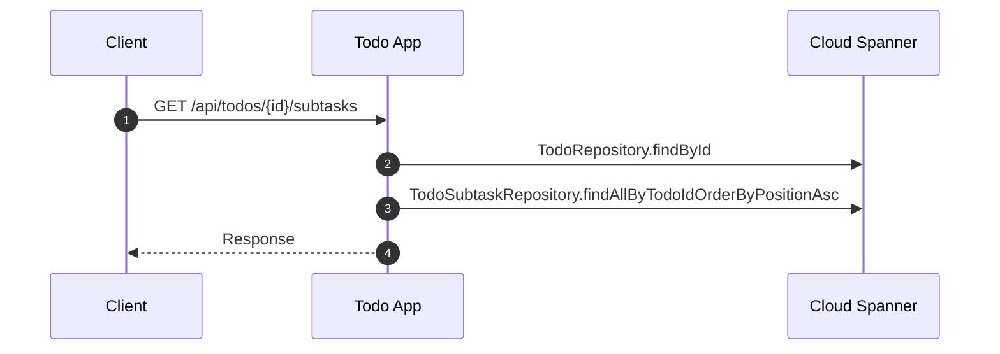

## PATCH /api/todos/{id}/subtasks/{subtaskId}

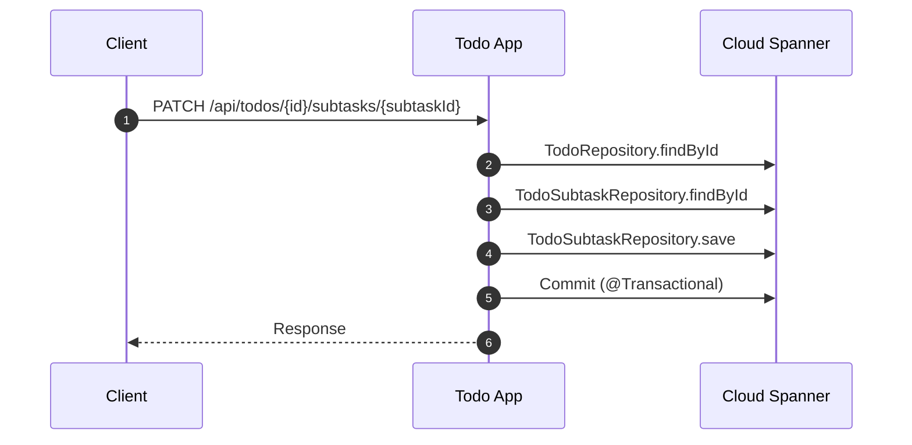

## DELETE /api/todos/{id}/subtasks/{subtaskId}

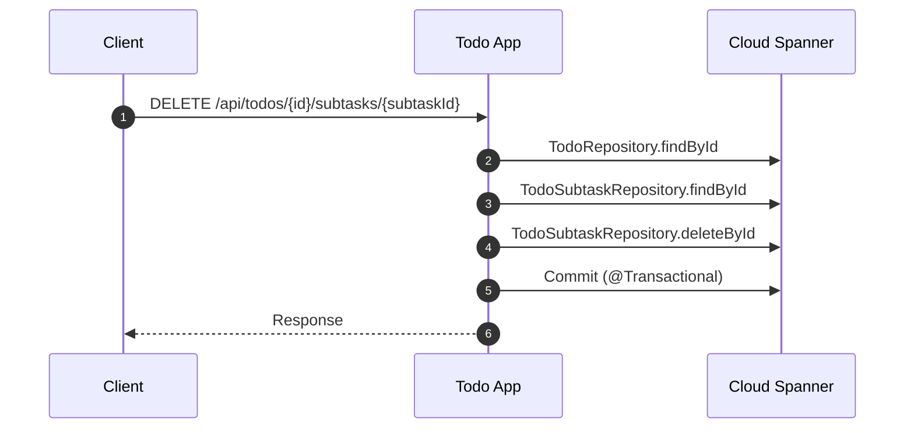

## POST /api/todos/{id}/comments

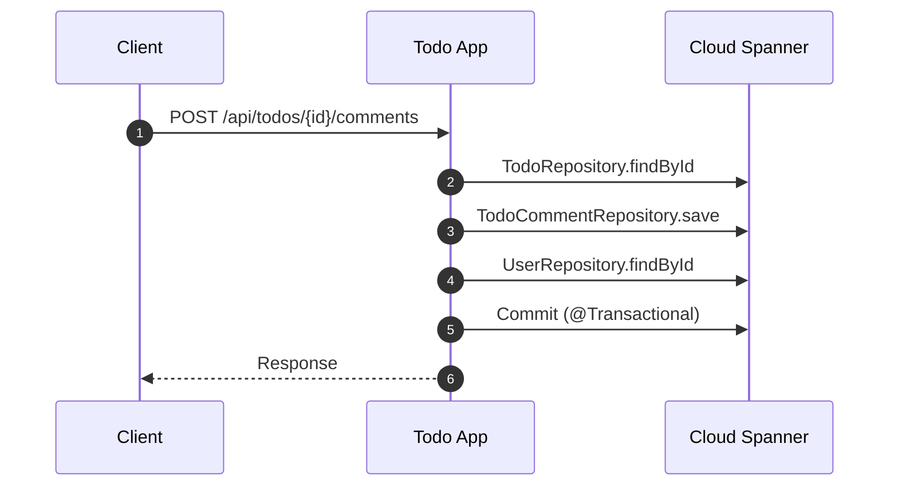

## GET /api/todos/{id}/comments

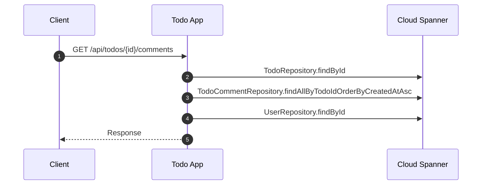

## DELETE /api/todos/{id}/comments/{commentId}

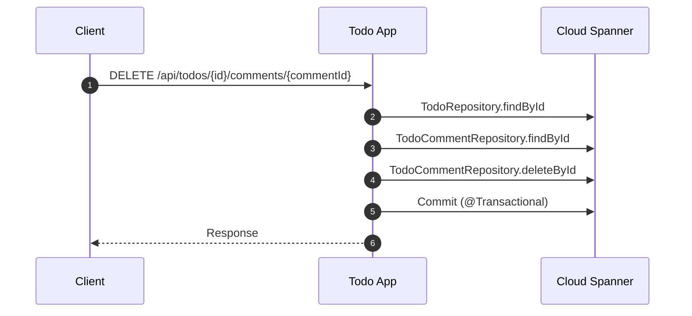

## DELETE /api/todos/{id}

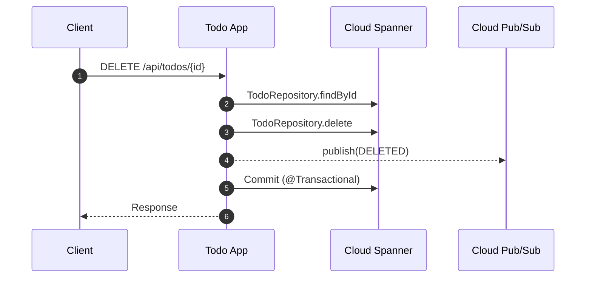

## POST /api/projects

```mermaid
sequenceDiagram
    autonumber
    participant Client
    participant App as Todo App
    participant Spanner as Cloud Spanner
    Client->>App: POST /api/projects
    App->>Spanner: ProjectRepository.save
    App->>Spanner: ProjectMemberRepository.save
    App->>Spanner: Commit (@Transactional)
    App-->>Client: Response
```

## GET /api/projects

```mermaid
sequenceDiagram
    autonumber
    participant Client
    participant App as Todo App
    participant Spanner as Cloud Spanner
    Client->>App: GET /api/projects
    App->>Spanner: ProjectMemberRepository.findAllByUserId
    App->>Spanner: ProjectRepository.findAllByIdIn
    App-->>Client: Response
```

## GET /api/projects/{projectId}

```mermaid
sequenceDiagram
    autonumber
    participant Client
    participant App as Todo App
    participant Spanner as Cloud Spanner
    Client->>App: GET /api/projects/{projectId}
    App->>Spanner: ProjectMemberRepository.findByProjectIdAndUserId
    App->>Spanner: ProjectRepository.findById
    App-->>Client: Response
```

## PUT /api/projects/{projectId}

```mermaid
sequenceDiagram
    autonumber
    participant Client
    participant App as Todo App
    participant Spanner as Cloud Spanner
    Client->>App: PUT /api/projects/{projectId}
    App->>Spanner: ProjectMemberRepository.findByProjectIdAndUserId
    App->>Spanner: ProjectRepository.findById
    App->>Spanner: ProjectRepository.save
    App->>Spanner: Commit (@Transactional)
    App-->>Client: Response
```

## POST /api/projects/{projectId}/members

```mermaid
sequenceDiagram
    autonumber
    participant Client
    participant App as Todo App
    participant Spanner as Cloud Spanner
    Client->>App: POST /api/projects/{projectId}/members
    App->>Spanner: ProjectMemberRepository.findByProjectIdAndUserId
    App->>Spanner: UserRepository.findByUsername
    App->>Spanner: ProjectMemberRepository.findByProjectIdAndUserId
    App->>Spanner: ProjectMemberRepository.save
    App->>Spanner: Commit (@Transactional)
    App-->>Client: Response
```

## GET /api/projects/{projectId}/members

```mermaid
sequenceDiagram
    autonumber
    participant Client
    participant App as Todo App
    participant Spanner as Cloud Spanner
    Client->>App: GET /api/projects/{projectId}/members
    App->>Spanner: ProjectMemberRepository.findByProjectIdAndUserId
    App->>Spanner: ProjectMemberRepository.findAllByProjectId
    App->>Spanner: UserRepository.findAllByIdIn
    App-->>Client: Response
```

## DELETE /api/projects/{projectId}/members/{userId}

```mermaid
sequenceDiagram
    autonumber
    participant Client
    participant App as Todo App
    participant Spanner as Cloud Spanner
    Client->>App: DELETE /api/projects/{projectId}/members/{userId}
    App->>Spanner: ProjectMemberRepository.findByProjectIdAndUserId
    App->>Spanner: ProjectMemberRepository.findByProjectIdAndUserId
    App->>Spanner: ProjectMemberRepository.deleteByProjectIdAndUserId
    App->>Spanner: Commit (@Transactional)
    App-->>Client: Response
```

## DELETE /api/projects/{projectId}

```mermaid
sequenceDiagram
    autonumber
    participant Client
    participant App as Todo App
    participant Spanner as Cloud Spanner
    Client->>App: DELETE /api/projects/{projectId}
    App->>Spanner: ProjectMemberRepository.findByProjectIdAndUserId
    App->>Spanner: ProjectRepository.findById
    App->>Spanner: TodoRepository.deleteAllByProjectId
    App->>Spanner: ProjectMemberRepository.deleteAllByProjectId
    App->>Spanner: ProjectRepository.deleteById
    App->>Spanner: Commit (@Transactional)
    App-->>Client: Response
```

