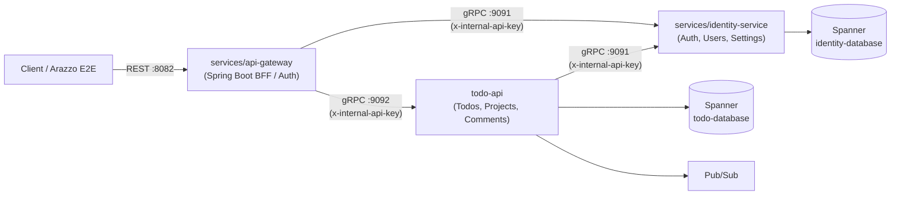

# Microservices Architecture

## Service Topology

## Module Layout

| Module | Type | Ports | Responsibility |
| --- | --- | --- | --- |
| `:libs:grpc-common` | Library | — | Shared gRPC interceptors (`InternalApiKeyGrpcInterceptor`, `TracingGrpcClientInterceptor`, `TracingGrpcServerInterceptor`) |
| `:libs:identity-proto` | Library | — | Shared Protobuf / gRPC contract (`identity/v1/identity.proto`) |
| `:libs:todo-proto` | Library | — | Shared Protobuf / gRPC contract (`todo/v1/todo.proto` — `TodoService` & `ProjectService`) |
| `:services:api-gateway` | Spring Boot | HTTP `8082` | External REST entry point, centralized JWT & `X-Admin-Key` auth, gRPC-to-HTTP translation for all services |
| `:services:identity-service` | Spring Boot | gRPC `9091`, HTTP `8081` | Identity bounded context (`Auth`, `User`, `UserSettings`, `AdminUser`), Spanner `identity-database` |
| `:services:todo-service` | Spring Boot | gRPC `9092`, HTTP `8080` | Todo & Project bounded contexts (`Todo`, `Subtask`, `Comment`, `Project`, `AdminStats`), exposes gRPC APIs and calls `identity-service` over gRPC when `identity.service.enabled=true` |

## Security Boundaries

- **External → `api-gateway`**:
  - `/api/auth/**`: Public
  - `/api/admin/**`, `/actuator/**`: `X-Admin-Key` header (constant-time comparison)
  - All other `/api/**`: `Authorization: Bearer <JWT>`
- **Internal (`api-gateway` → `identity-service` / `todo-api`, `todo-api` → `identity-service`)**:
  - All service-to-service calls use gRPC (`:9091` / `:9092`) with `x-internal-api-key` metadata verified by `InternalApiKeyGrpcInterceptor`, W3C `traceparent` propagation via OpenTelemetry gRPC interceptors, and optional TLS + HTTP/2 keepalive.
  - Both `identity-service` and `todo-api` expose standard gRPC Health Checking (`grpc.health.v1.Health`).
  - Default insecure secrets are blocked at startup on non-local profiles by `SecurityStartupValidator` across all three services.

## Strangler Fig Migration Roadmap

1. **Completed**: Extract `:services:identity-service` with dedicated Spanner database (`#149`).
2. **Completed**: Add `:libs:identity-proto`, gRPC server in `identity-service`, and Spring Boot `:services:api-gateway` (`#155`).
3. **Completed**: Unify all internal `todo-api` → `identity-service` calls onto gRPC and remove obsolete HTTP `/internal/**` endpoints (`#156`).
4. **Completed**: Add `:libs:todo-proto` (`TodoService` & `ProjectService`), expose gRPC server (`:9092`) in `todo-api`, and migrate `api-gateway` completely off the transitional HTTP proxy onto gRPC (`#157`).
5. **Completed**: Run Arazzo E2E workflows through `api-gateway` (`:8082`) in `e2e-microservices`, propagate W3C trace context across gRPC, and enable JaCoCo / ArchUnit / CycloneDX SBOM quality gates across microservices.
6. **Next**: Split `project-service` into its own deployable service if needed, and remove legacy identity code from root `todo-api`.
