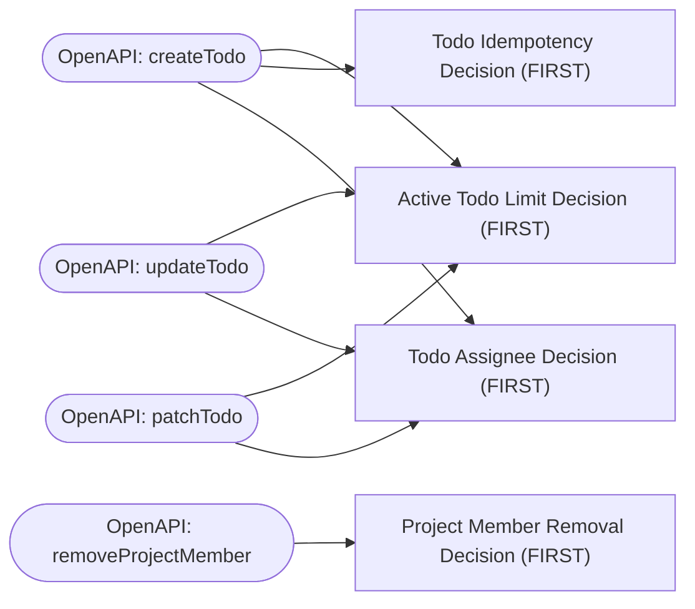

# OMG DMN 1.3 ディシジョンモデル

<!-- AUTO-GENERATED from docs/models/todo-decisions.dmn by scripts/generate-dmn-diagrams.mjs -->

## Decision Requirements Diagram (DRD)

## Active Todo Limit Decision (`activeTodoLimitDecision`)

Evaluates whether a personal Todo mutation requires an active-todo limit check and whether the DB active count exceeds the user setting.

- **Hit Policy**: `FIRST`
- **OpenAPI operations**: `createTodo`, `updateTodo`, `patchTodo`

| # | Rule ID | hasProject (boolean) | operation (string) | currentCompleted (boolean) | targetCompleted (boolean) | hasMaxActiveLimit (boolean) | atOrAboveLimit (boolean) | **checkRequired** (boolean) | **decision** (string) | **httpStatus** (integer) | Description |
| --- | --- | --- | --- | --- | --- | --- | --- | --- | --- | --- | --- |
| 1 | `active_project_exempt` | `true` | `-` | `-` | `-` | `-` | `-` | **`false`** | **`"ALLOW"`** | **`200`** | Project todos are exempt from personal active-todo limits. |
| 2 | `active_create_limit_exceeded` | `false` | `"createTodo"` | `-` | `false` | `true` | `true` | **`true`** | **`"DENY_ACTIVE_LIMIT_EXCEEDED"`** | **`400`** | Creating an active personal todo when active count is at or above limit is denied. |
| 3 | `active_create_allowed` | `false` | `"createTodo"` | `-` | `false` | `-` | `-` | **`true`** | **`"ALLOW"`** | **`201`** | Creating an active personal todo below limit (or without limit) is allowed. |
| 4 | `active_update_reopen_limit_exceeded` | `false` | `"updateTodo"` | `true` | `false` | `true` | `true` | **`true`** | **`"DENY_ACTIVE_LIMIT_EXCEEDED"`** | **`400`** | Reopening a completed personal todo via PUT when at or above limit is denied. |
| 5 | `active_update_reopen_allowed` | `false` | `"updateTodo"` | `true` | `false` | `-` | `-` | **`true`** | **`"ALLOW"`** | **`200`** | Reopening a completed personal todo via PUT below limit is allowed. |
| 6 | `active_patch_reopen_limit_exceeded` | `false` | `"patchTodo"` | `true` | `false` | `true` | `true` | **`true`** | **`"DENY_ACTIVE_LIMIT_EXCEEDED"`** | **`400`** | Reopening a completed personal todo via PATCH when at or above limit is denied. |
| 7 | `active_patch_reopen_allowed` | `false` | `"patchTodo"` | `true` | `false` | `-` | `-` | **`true`** | **`"ALLOW"`** | **`200`** | Reopening a completed personal todo via PATCH below limit is allowed. |
| 8 | `active_default_allowed` | `-` | `-` | `-` | `-` | `-` | `-` | **`false`** | **`"ALLOW"`** | **`200`** | All other mutations do not increase the active todo count. |

## Project Member Removal Decision (`projectMemberRemovalDecision`)

Evaluates authorization and last-owner invariants when removing a member from a project.

- **Hit Policy**: `FIRST`
- **OpenAPI operations**: `removeProjectMember`

| # | Rule ID | isSelfRemoval (boolean) | actorRole (string) | targetExists (boolean) | targetRole (string) | isLastOwner (boolean) | **decision** (string) | **httpStatus** (integer) | Description |
| --- | --- | --- | --- | --- | --- | --- | --- | --- | --- |
| 1 | `member_non_owner_cannot_remove_others` | `false` | `"MEMBER"` | `-` | `-` | `-` | **`"DENY_FORBIDDEN"`** | **`403`** | Only project owners can remove other members. |
| 2 | `member_target_not_found` | `-` | `-` | `false` | `-` | `-` | **`"DENY_NOT_FOUND"`** | **`404`** | Target user must be an existing member of the project. |
| 3 | `member_last_owner_protected` | `-` | `-` | `true` | `"OWNER"` | `true` | **`"DENY_LAST_OWNER"`** | **`409`** | The last remaining owner of a project cannot be removed. |
| 4 | `member_removal_allowed` | `-` | `-` | `-` | `-` | `-` | **`"ALLOW"`** | **`204`** | All other valid member removals are permitted. |

## Todo Idempotency Decision (`idempotencyDecision`)

Evaluates whether an idempotent Todo creation replays a cached response, rejects as conflict, or creates a new Todo.

- **Hit Policy**: `FIRST`
- **OpenAPI operations**: `createTodo`

| # | Rule ID | recordExists (boolean) | recordActive (boolean) | fingerprintMatches (boolean) | **decision** (string) | **httpStatus** (integer) | Description |
| --- | --- | --- | --- | --- | --- | --- | --- |
| 1 | `idem_replay_existing` | `true` | `true` | `true` | **`"REPLAY_EXISTING"`** | **`201`** | Active record with matching fingerprint replays the original response. |
| 2 | `idem_conflict` | `true` | `true` | `false` | **`"DENY_CONFLICT"`** | **`409`** | Active record with different fingerprint is rejected as 409 Conflict. |
| 3 | `idem_create_new` | `-` | `-` | `-` | **`"CREATE_NEW"`** | **`201`** | Missing or expired record proceeds to create a new Todo. |

## Todo Assignee Decision (`todoAssigneeDecision`)

Evaluates whether assigning a user to a Todo is permitted based on project scope and membership.

- **Hit Policy**: `FIRST`
- **OpenAPI operations**: `createTodo`, `updateTodo`, `patchTodo`

| # | Rule ID | hasAssignee (boolean) | hasProject (boolean) | isAssigneeProjectMember (boolean) | **decision** (string) | **httpStatus** (integer) | Description |
| --- | --- | --- | --- | --- | --- | --- | --- |
| 1 | `assignee_unassigned_allowed` | `false` | `-` | `-` | **`"ALLOW"`** | **`200`** | No assignee specified is always allowed. |
| 2 | `assignee_personal_todo_denied` | `true` | `false` | `-` | **`"DENY_PERSONAL_TODO"`** | **`400`** | Assignee cannot be set on personal todos outside a project. |
| 3 | `assignee_non_member_denied` | `true` | `true` | `false` | **`"DENY_NOT_PROJECT_MEMBER"`** | **`400`** | Assignee must be a member of the Todo's project. |
| 4 | `assignee_project_member_allowed` | `-` | `-` | `-` | **`"ALLOW"`** | **`200`** | Assigning a project member to a project todo is allowed. |

