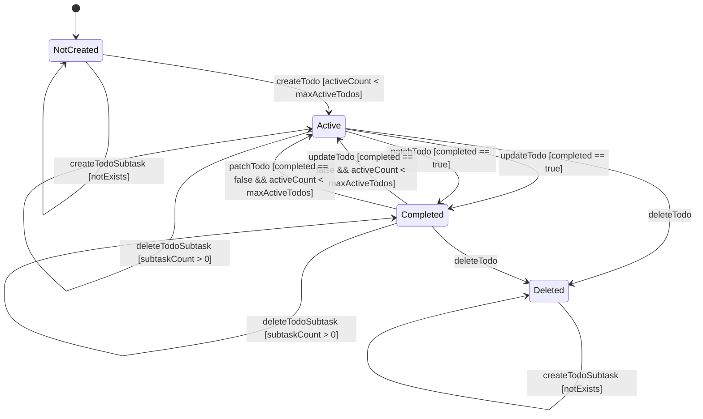

# モデルベースドテスト状態遷移仕様 (W3C SCXML)

> **自動生成ドキュメント**: 本ドキュメントは `docs/models/*.scxml` からスクリプト（`npm run generate:scxml-diagrams`）により自動生成されています。手動編集は行わず、SCXML ファイルを直接更新してください。

## TodoLifecycleModel (`todo-lifecycle.scxml`)

- **初期状態**: `NotCreated`
- **対象 OpenAPI `operationId` (12件)**: `createTodo`, `createTodoSubtask`, `deleteTodo`, `deleteTodoSubtask`, `getTodo`, `getUserSettings`, `listTodoSubtasks`, `listTodos`, `patchTodo`, `patchTodoSubtask`, `updateTodo`, `updateUserSettings`

