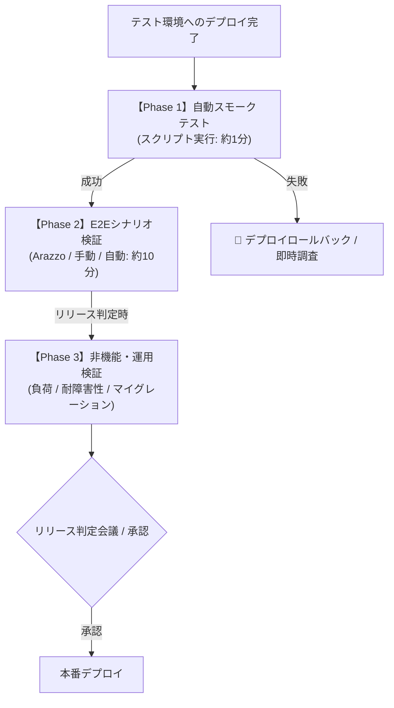

# テスト環境（Staging / QA）テスト仕様書・管理台帳

本ドキュメントは、テスト環境（ステージング / QA / 検証環境）で実施するテストの仕様、実行手順、判定基準、および管理方法を定義します。全体のテスト方針・ピラミッド設計については [テスト戦略 (test-strategy.md)](test-strategy.md) を参照してください。

---

## 1. テスト環境テストの位置づけと運用フロー

`src/integrationTest`（CI自動テスト）をパスしたコードがテスト環境にデプロイされた後、以下の 3 つのフェーズで検証を実施します。



---

## 2. テストケース一覧と仕様（B-01 〜 B-11）

### Phase 1: インフラ疎通・スモークテスト（デプロイ直後に自動実行）

| ID | テストケース名 | 実行主体 | 前提条件・入力 | 合格判定基準 | 実行手段 / コマンド例 |
| :--- | :--- | :--- | :--- | :--- | :--- |
| **B-01** | Spanner 疎通 & IAM | 自動 | アプリが起動していること | Spanner への読み書きクエリが 403 PERMISSION_DENIED なしで実行できること | `./scripts/smoke-test.sh` |
| **B-02** | Pub/Sub 権限疎通 | 自動/手動 | テスト用トピックが存在すること | メッセージ Publish 時に IAM 認証エラーが発生しないこと | `./scripts/smoke-test.sh` |
| **B-03** | SSL / ドメイン / ALB 疎通 | 自動 | ドメイン経由で HTTPS リクエスト | 有効な証明書で 200 OK が返り、`/actuator/health` が `UP` であること | `curl -f -k https://<STAGING_HOST>/actuator/health` |
| **B-04** | CORS / セキュリティヘッダ | 自動 | 指定オリジンからの Preflight リクエスト | 許可された Origin にのみ `Access-Control-Allow-Origin` が返ること | `curl -X OPTIONS -H "Origin: https://app.staging.example.com" -I ...` |
| **B-05** | Secret 注入 & JWT 署名 | 自動 | Secret Manager の鍵が注入されていること | 生成された JWT トークンが正しく署名・復号できること | `./scripts/smoke-test.sh` のログインステップ |

---

### Phase 2: E2E シナリオ・外部連携テスト（機能リリース前）

| ID | テストケース名 | 実行主体 | 前提条件・入力 | 合格判定基準 | 実行手段 / コマンド例 |
| :--- | :--- | :--- | :--- | :--- | :--- |
| **B-06** | ライフサイクル E2E | 自動 / QA | Web UI または API クライアント | [登録 $\rightarrow$ ログイン $\rightarrow$ TODO作成 $\rightarrow$ 設定変更 $\rightarrow$ 完了 $\rightarrow$ 削除] がエラーなく完了すること | [todo-workflows.arazzo.yaml](../workflows/todo-workflows.arazzo.yaml) または UI 操作 |
| **B-07** | 非同期通知 / 外部連携 | 手動 / QA | メール/Slack 等の通知先設定 | TODO 作成・更新に伴う外部通知（実連携）が受信できること | 実際にテスト用 Slack チャンネル等を確認 |

---

### Phase 3: 非機能・運用検証（大規模リリース / 定期検証）

| ID | テストケース名 | 実行主体 | 前提条件・入力 | 合格判定基準 | 実行手段 / コマンド例 |
| :--- | :--- | :--- | :--- | :--- | :--- |
| **B-08** | 負荷・スループット | SRE / 自動 | 負荷テストツール（k6等） | 想定ピーク負荷（例: 500 RPS）を 10 分間継続し、p99 < 300ms、エラー率 < 0.1% | `k6 run load-test.js -e TARGET_URL=...` |
| **B-09** | オートスケール (HPA) | SRE | 負荷増大状態 | CPU/メモリ閾値超過で Pod / インスタンスが正常にスケールアウトすること | Cloud Monitoring / `kubectl get hpa` |
| **B-10** | 無停止ローリング更新 | SRE | トラフィック印加状態 | デプロイ中に 502 / 503 エラーが発生しないこと（Graceful Shutdown） | 負荷印加中に新イメージをデプロイ |
| **B-11** | DB マイグレーション検証 | Dev / DBA | 本番相当データが入ったステージング DB | DDL 適用時にテーブルロックで API が停止せず、所定時間内に完了すること | マイグレーション実行と同時に GET API をポーリング |

---

## 3. テストデータの管理方針

1. **シードデータ（ベースライン）**:
   - ステージング環境には初期確認用の固定アカウント（例: `staging-tester@example.com`）を常に用意する。
2. **テスト自動生成データ**:
   - 自動テストで作成するエンティティには必ずプレフィックス `test-staging-[UUID]` を付与する。
   - 毎日深夜のバッチ処理またはテストスクリプト末尾で `test-staging-*` のデータを削除する。
3. **本番データコピー（データマスキング）**:
   - パフォーマンステストやマイグレーション検証用に本番 DB のバックアップを利用する場合、個人情報・機密情報を必ず匿名化・マスキングしてからステージング DB へリストアする。

---

## 4. リリース前チェックリスト（テンプレート）

リリース作業時の PR や Issue に以下のチェックリストを貼り付けて管理します。

```markdown
### テスト環境検証チェックリスト (Release: vX.Y.Z)
- [ ] **Phase 1: 自動スモークテスト**
  - [ ] B-01〜B-05: `./scripts/smoke-test.sh` 実行成功
- [ ] **Phase 2: E2E・業務シナリオ**
  - [ ] B-06: ユーザーライフサイクル E2E 完了 (Arazzo / 手動)
  - [ ] B-07: 外部連携・通知の着信確認
- [ ] **Phase 3: 非機能・運用（該当する場合のみ）**
  - [ ] B-08: 負荷テスト実施（レイテンシ・エラー率クリア）
  - [ ] B-11: DB マイグレーション適用完了・データ破損なし
- [ ] **サインオフ**
  - [ ] 担当者: @username
  - [ ] 承認日: YYYY-MM-DD
```

