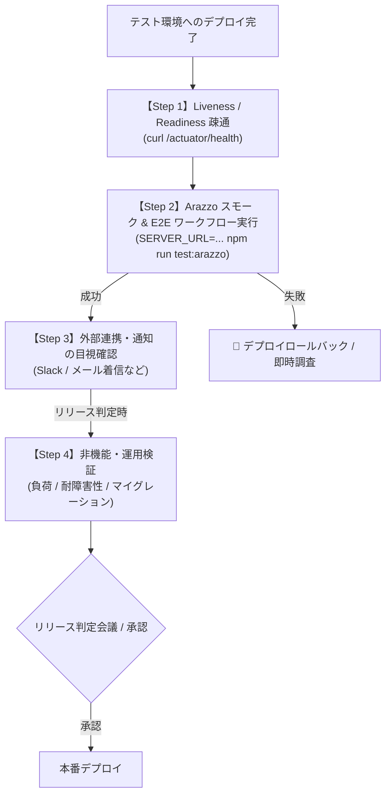

# テスト環境（Staging / QA）テスト仕様書・管理台帳

本ドキュメントは、テスト環境（ステージング / QA / 検証環境）で実施するテストの仕様、実行手順、判定基準、および管理方法を定義します。全体のテスト方針・ピラミッド設計については [テスト戦略 (test-strategy.md)](test-strategy.md) を参照してください。

---

## 1. テスト環境テストの位置づけと運用フロー

`src/integrationTest`（CI自動テスト）をパスしたコードがテスト環境にデプロイされた後、以下の運用フローで検証を実施します。
デプロイ直後のスモークテスト（基本機能疎通）および E2E シナリオ検証は、**Arazzo ワークフロー仕様（[`docs/workflows/todo-workflows.arazzo.yaml`](../workflows/todo-workflows.arazzo.yaml)）を実行する `npm run test:arazzo` に一本化**します。



---

## 2. Arazzo ワークフローテスト（スモーク & E2E の一本化）

本プロジェクトでは **Redocly Respect (`redocly respect`)** を用い、Arazzo ワークフロー定義に従ってテスト環境へのスモーク・E2E 疎通を自動実行します。
別個のシェルスクリプト（curl 等）を二重管理せず、**OpenAPI / Arazzo 仕様を唯一の正本（SSOT）としてテストを実行**します。

### 実行コマンド（環境ポータビリティ）
同一のワークフローを、ローカル開発環境に対しても実環境に対しても全く同じコマンド体系で実行できます。

```bash
# 1. テスト環境（ステージング / QA）への実行（デプロイ直後のスモーク・E2E検証）
SERVER_URL=https://staging-api.example.com npm run test:arazzo

# 2. ローカル開発環境（localhost:8080）への実行（起動後のクイック動作確認）
npm run test:arazzo
```

### 自動検証される 2 大ワークフロー
1. **`user-todo-lifecycle` (一般ユーザー ライフサイクル)**
   - ユーザー登録 (`POST /api/auth/register`) $\rightarrow$ Spanner 書き込み検証
   - ログイン & JWT 取得 (`POST /api/auth/login`) $\rightarrow$ Secret 注入・署名検証
   - 設定取得 & 更新 (`GET/PUT /api/user/settings`)
   - TODO 作成 (`POST /api/todos`) $\rightarrow$ Idempotency-Key 制御 & Pub/Sub イベント発行
   - TODO 取得・更新・一覧・削除 (`GET/PUT/DELETE /api/todos/{id}`) $\rightarrow$ データ完全削除
2. **`admin-audit-lifecycle` (管理者 ライフサイクル)**
   - API キー認証による管理者統計取得 (`GET /api/admin/stats`)
   - 登録ユーザー一覧取得 (`GET /api/admin/users`)

---

## 3. テストケース一覧と仕様（B-01 〜 B-10）

### Step 1 & 2: インフラ疎通・スモーク & E2E ワークフロー（デプロイ直後自動実行）

| ID | テストケース名 | 実行主体 | 前提条件・入力 | 合格判定基準 | 推奨実行手段 / コマンド |
| :--- | :--- | :--- | :--- | :--- | :--- |
| **B-01** | 基本死活監視 (Liveness) | 自動 | コンテナ起動完了 | `/actuator/health` が HTTP 200 かつ status `UP` を返すこと | `curl -f -k https://<HOST>/actuator/health` |
| **B-02** | SSL / ドメイン / ALB 疎通 | 自動 | ドメイン経由で HTTPS リクエスト | 有効な SSL 証明書で暗号化通信が行えること | `curl -I https://<HOST>/actuator/health` |
| **B-03** | Spanner 疎通 & IAM | 自動 | アプリが起動していること | Arazzo 内の登録・TODO 作成・取得クエリが IAM エラーなく完了すること | `SERVER_URL=... npm run test:arazzo` |
| **B-04** | Pub/Sub 権限疎通 | 自動 | トピックが存在すること | Arazzo 内の TODO 作成・削除に伴うイベント発行が IAM エラーなく成功すること | `SERVER_URL=... npm run test:arazzo` |
| **B-05** | Secret 注入 & JWT 署名 | 自動 | Secret Manager の鍵が注入されていること | ログインステップで発行された JWT が後続の TODO API で正しく認証されること | `SERVER_URL=... npm run test:arazzo` |
| **B-06** | ライフサイクル E2E 貫通 | 自動 | 実環境エンドポイント | 一般ユーザーの一連の操作（登録〜削除）および管理者監査が全ステップ PASS すること | **`SERVER_URL=... npm run test:arazzo`** |
| **B-07** | 非同期通知 / 外部連携 | 手動 / QA | メール/Slack 等の通知先設定 | Arazzo 実行に伴い、テスト用 Slack/メールに通知が正常に着信すること | 外部サービス側の着信を確認 |

---

### Step 4: 非機能・運用検証（大規模リリース / 定期検証）

| ID | テストケース名 | 実行主体 | 前提条件・入力 | 合格判定基準 | 実行手段 / コマンド例 |
| :--- | :--- | :--- | :--- | :--- | :--- |
| **B-08** | 負荷・スループット | SRE / 自動 | 負荷テストツール（k6等） | 想定ピーク負荷（例: 500 RPS）を 10 分間継続し、p99 < 300ms、エラー率 < 0.1% | `k6 run load-test.js -e TARGET_URL=...` |
| **B-09** | オートスケール (HPA) | SRE | 負荷増大状態 | CPU/メモリ閾値超過で Pod / インスタンスが正常にスケールアウトすること | Cloud Monitoring / `kubectl get hpa` |
| **B-10** | 無停止ローリング更新 | SRE | トラフィック印加状態 | デプロイ中に 502 / 503 エラーが発生しないこと（Graceful Shutdown） | 負荷印加中に新イメージをデプロイ |
| **B-11** | DB マイグレーション検証 | Dev / DBA | 本番相当データが入ったステージング DB | DDL 適用時にテーブルロックで API が停止せず、所定時間内に完了すること | マイグレーション実行と同時に GET API をポーリング |

---

## 4. テストデータの管理方針

1. **Arazzo による自動クリーンアップ**:
   - Arazzo ワークフローは実行時に動的なユーザー名（デフォルト: `arazzo-user` または環境変数で渡す UUID）で登録を行い、**ワークフローの最終ステップで作成した TODO を必ず DELETE して自己パージ**します。
2. **シードデータ（ベースライン）**:
   - 事前動作確認用の固定アカウント（例: `staging-tester@example.com`）をステージング DB に保持します。
3. **本番データコピー（データマスキング）**:
   - パフォーマンステストやマイグレーション検証用に本番 DB のバックアップを利用する場合、個人情報・機密情報を必ず匿名化・マスキングしてからステージング DB へリストアします。

---

## 5. リリース前チェックリスト（テンプレート）

リリース作業時の PR や Issue に以下のチェックリストを貼り付けて管理します。

```markdown
### テスト環境検証チェックリスト (Release: vX.Y.Z)
- [ ] **Step 1 & 2: Arazzo 自動ワークフロー・疎通検証**
  - [ ] B-01: `/actuator/health` 疎通確認 (UP)
  - [ ] B-02〜B-06: `SERVER_URL=https://<STAGING_URL> npm run test:arazzo` (100% PASS)
  - [ ] B-07: 外部連携・Slack等の通知着信確認
- [ ] **Step 4: 非機能・運用（該当する場合のみ）**
  - [ ] B-08: 負荷テスト実施（レイテンシ・エラー率クリア）
  - [ ] B-11: DB マイグレーション適用完了・データ破損なし
- [ ] **サインオフ**
  - [ ] 担当者: @username
  - [ ] 承認日: YYYY-MM-DD
```
