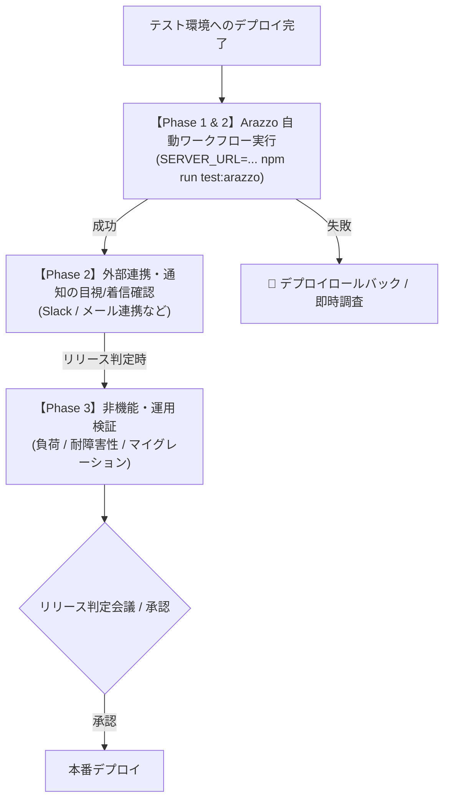

# テスト環境（Staging / QA）テスト仕様書・管理台帳

本ドキュメントは、テスト環境（ステージング / QA / 検証環境）で実施するテストの仕様、実行手順、判定基準、および管理方法を定義します。全体のテスト方針・ピラミッド設計については [テスト戦略 (test-strategy.md)](test-strategy.md) を参照してください。

---

## 1. テスト環境テストの位置づけと運用フロー

`src/integrationTest`（CI自動テスト）をパスしたコードがテスト環境にデプロイされた後、以下の 3 つのフェーズで検証を実施します。
実環境における API の E2E シナリオおよびスモーク疎通は、**Arazzo ワークフロー仕様（[`docs/workflows/todo-workflows.arazzo.yaml`](../workflows/todo-workflows.arazzo.yaml)）を実行する `npm run test:arazzo`** を第一級のテストランナーとして採用します。



---

## 2. Arazzo ワークフローテスト（実環境テストの中核）

本リポジトリでは **Redocly Respect (`redocly respect`)** を用い、Arazzo ワークフロー定義に従って実環境への E2E 疎通を自動実行します。

### 実行コマンド
```bash
# ステージング環境への実行
SERVER_URL=https://staging-api.example.com npm run test:arazzo

# ローカル起動環境への実行（デフォルト: http://localhost:8080）
npm run test:arazzo
```

### 検証されるワークフロー
1. **`user-todo-lifecycle` (一般ユーザー ライフサイクル)**
   - ユーザー登録 (`POST /api/auth/register`)
   - ログイン & JWT 取得 (`POST /api/auth/login`)
   - 設定取得 & 更新 (`GET/PUT /api/user/settings`)
   - TODO 作成 (`POST /api/todos`) ※Idempotency-Key 含む
   - TODO 取得・更新・一覧・削除 (`GET/PUT/DELETE /api/todos/{id}`)
2. **`admin-audit-lifecycle` (管理者 ライフサイクル)**
   - API キー認証による管理者統計取得 (`GET /api/admin/stats`)
   - 登録ユーザー一覧取得 (`GET /api/admin/users`)

---

## 3. テストケース一覧と仕様（B-01 〜 B-11）

### Phase 1 & 2: インフラ疎通・E2E ワークフロー（デプロイ直後・自動実行）

| ID | テストケース名 | 実行主体 | 前提条件・入力 | 合格判定基準 | 推奨実行手段 / コマンド |
| :--- | :--- | :--- | :--- | :--- | :--- |
| **B-01** | Spanner 疎通 & IAM | 自動 | アプリが起動していること | Spanner への読み書きクエリが 403 PERMISSION_DENIED なしで実行できること | `SERVER_URL=... npm run test:arazzo`<br>(または `./scripts/smoke-test.sh`) |
| **B-02** | Pub/Sub 権限疎通 | 自動/手動 | テスト用トピックが存在すること | メッセージ Publish 時に IAM 認証エラーが発生しないこと | `SERVER_URL=... npm run test:arazzo`<br>(または `./scripts/smoke-test.sh`) |
| **B-03** | SSL / ドメイン / ALB 疎通 | 自動 | ドメイン経由で HTTPS リクエスト | 有効な証明書で 200 OK が返り、`/actuator/health` が `UP` であること | `curl -f -k https://<HOST>/actuator/health` |
| **B-04** | CORS / セキュリティヘッダ | 自動 | 指定オリジンからの Preflight リクエスト | 許可された Origin にのみ `Access-Control-Allow-Origin` が返ること | `curl -X OPTIONS -H "Origin: https://app.example.com" -I ...` |
| **B-05** | Secret 注入 & JWT 署名 | 自動 | Secret Manager の鍵が注入されていること | 生成された JWT トークンが正しく署名・復号できること | `SERVER_URL=... npm run test:arazzo` |
| **B-06** | ライフサイクル E2E | 自動 | 実環境エンドポイント | [登録 $\rightarrow$ ログイン $\rightarrow$ 設定 $\rightarrow$ TODO作成 $\rightarrow$ 完了 $\rightarrow$ 削除] がエラーなく完了すること | **`SERVER_URL=... npm run test:arazzo`** |
| **B-07** | 非同期通知 / 外部連携 | 手動 / QA | メール/Slack 等の通知先設定 | TODO 作成・更新に伴う外部通知（実連携）が受信できること | 実際にテスト用 Slack チャンネル等を確認 |

> **補足（`smoke-test.sh` について）**:
> Node.js / npm 環境がない軽量コンテナや curl のみ利用可能なデプロイパイプラインでは、代替手段として [`./scripts/smoke-test.sh`](../../scripts/smoke-test.sh) を利用できます。

---

### Phase 3: 非機能・運用検証（大規模リリース / 定期検証）

| ID | テストケース名 | 実行主体 | 前提条件・入力 | 合格判定基準 | 実行手段 / コマンド例 |
| :--- | :--- | :--- | :--- | :--- | :--- |
| **B-08** | 負荷・スループット | SRE / 自動 | 負荷テストツール（k6等） | 想定ピーク負荷（例: 500 RPS）を 10 分間継続し、p99 < 300ms、エラー率 < 0.1% | `k6 run load-test.js -e TARGET_URL=...` |
| **B-09** | オートスケール (HPA) | SRE | 負荷増大状態 | CPU/メモリ閾値超過で Pod / インスタンスが正常にスケールアウトすること | Cloud Monitoring / `kubectl get hpa` |
| **B-10** | 無停止ローリング更新 | SRE | トラフィック印加状態 | デプロイ中に 502 / 503 エラーが発生しないこと（Graceful Shutdown） | 負荷印加中に新イメージをデプロイ |
| **B-11** | DB マイグレーション検証 | Dev / DBA | 本番相当データが入ったステージング DB | DDL 適用時にテーブルロックで API が停止せず、所定時間内に完了すること | マイグレーション実行と同時に GET API をポーリング |

---

## 4. テストデータの管理方針

1. **Arazzo テスト実行時の自動生成データ**:
   - Arazzo ワークフロー（`todo-workflows.arazzo.yaml`）はテスト実行ごとに動的なユーザー名（デフォルト: `arazzo-user` または UUID プレフィックス）で登録を行い、最後に自身が作成した TODO をクリーンアップ（DELETE）します。
2. **シードデータ（ベースライン）**:
   - 事前動作確認用の固定アカウント（例: `staging-tester@example.com`）をステージング DB に保持します。
3. **本番データコピー（データマスキング）**:
   - パフォーマンステストやマイグレーション検証用に本番 DB のバックアップを利用する場合、個人情報・機密情報を必ず匿名化・マスキングしてからステージング DB へリストアします。

---

## 5. リリース前チェックリスト（テンプレート）

リリース作業時の PR や Issue に以下のチェックリストを貼り付けて管理します。

```markdown
### テスト環境検証チェックリスト (Release: vX.Y.Z)
- [ ] **Phase 1 & 2: Arazzo 自動ワークフロー・疎通検証**
  - [ ] `SERVER_URL=https://<STAGING_URL> npm run test:arazzo` (100% PASS)
  - [ ] B-03: `/actuator/health` 疎通確認 (UP)
  - [ ] B-07: 外部連携・Slack等の通知着信確認
- [ ] **Phase 3: 非機能・運用（該当する場合のみ）**
  - [ ] B-08: 負荷テスト実施（レイテンシ・エラー率クリア）
  - [ ] B-11: DB マイグレーション適用完了・データ破損なし
- [ ] **サインオフ**
  - [ ] 担当者: @username
  - [ ] 承認日: YYYY-MM-DD
```
