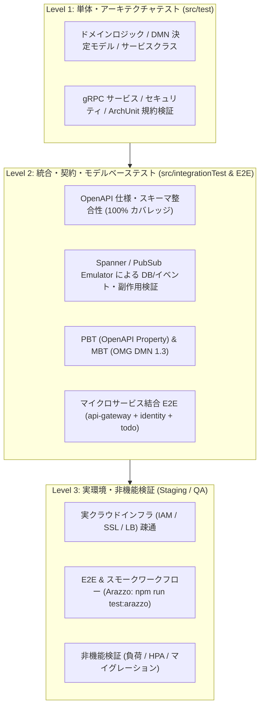
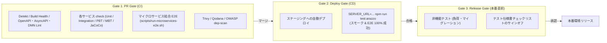

# プロジェクト テスト戦略 (Test Strategy)

本ドキュメントは、本リポジトリ（Kotlin / Spring Boot / gRPC マイクロサービス / Cloud Spanner / Pub/Sub）における品質保証の基本方針、テスト階層（テストピラミッド）、責務の切り分け基準、および CI/CD における品質ゲートを定義する全体戦略です。

---

## 1. 基本方針と原則

本プロジェクトのテスト戦略は、以下の 3 原則に基づきます。

1. **シフトレフト (Shift-Left) の徹底**
   - 仕様違反、バリデーション漏れ、DB制約違反、例外ハンドリングの不具合は、すべてコミット前の CI（`integrationTest`）で 100% 検出できるように自動化し、後工程（ステージング環境や本番）への持ち越しを防ぐ。
2. **OpenAPI / Arazzo 仕様駆動 (Spec-First Quality)**
   - API 仕様書（[`docs/openapi.yaml`](../openapi.yaml)）および E2E ワークフロー仕様（[`docs/workflows/todo-workflows.arazzo.yaml`](../workflows/todo-workflows.arazzo.yaml)）を正本（Single Source of Truth）とし、実装コード・単体/統合テスト・実環境 E2E テスト（Redocly Respect）を完全に同期させる。
   - **個別のシェルスクリプト（curl等）を二重管理せず、Arazzo ワークフローをスモークテストおよび E2E テストの唯一の実行基盤とする。**
3. **環境ポータビリティと責務分離**
   - Arazzo ワークフローは、**ローカル開発時（`localhost:8080`）のクイック検証**と**実環境（ステージング）デプロイ後のスモーク・E2E検証**で全く同じシナリオを再利用する。
   - 負荷・耐障害性・インフラ固有の挙動のみをテスト環境の非機能テストとして分離する。

---

## 2. テストピラミッドと階層構造



| テスト階層 | 配置場所 | 実行環境 / ツール | 実行時間目安 | 主な責務 |
| :--- | :--- | :--- | :--- | :--- |
| **単体・規約テスト (Unit / ArchUnit)** | 各モジュール `src/test/` | CI / ローカル (JUnit 5 / ArchUnit) | 数秒 | ドメイン・アプリケーションロジック、gRPC サービス、セキュリティ、レイヤー・スライス規約（エミュレータ不要） |
| **コンテナ統合テスト (Integration / 契約)** | `integration-tests/` (`docker-compose.test.yml`) | CI / ローカル (`bash scripts/run-container-integration-tests.sh`) | 2〜3分 | 全 3 マイクロサービス実コンテナ起動による OpenAPI 100% カバレッジ適合性、実 gRPC 通信、DB 永続化、WireMock メール送信検証 |
| **プロパティ・モデルベーステスト (PBT / MBT)** | `integration-tests/` (`@Tag("property")`) | CI / ローカル (`./gradlew propertyTest`) | 1〜2分 | 実コンテナ環境に対する OpenAPI スキーマ駆動のランダム入力検証 (Kotest Property) および OMG DMN 1.3 決定モデルの全ルール検証 |
| **Arazzo ワークフロー (Smoke & E2E)** | `docs/workflows/` | ローカル / CI / テスト環境 (`npm run test:arazzo`) | 約10秒 | ローカル開発時の動作確認、デプロイ直後スモーク、一連の業務ライフサイクルの実機貫通 |
| **非機能テスト (Non-Functional)** | 負荷・運用スクリプト | テスト環境 (k6 等) | 数十分 | ピークトラフィック耐性、無停止デプロイ、マイグレーション |

---

## 3. 責務とテスト切り分け基準

新しいテストケースを追加する際は、以下のフローチャートに従って実装場所を決定します。

```mermaid
flowchart TD
    Start["新しいテスト要件・シナリオ"] --> Q1{"GCP 実機環境や外部サードパーティ API、\n実際の負荷・UI 操作が必須か？"}
    Q1 -- "No (コードとエミュレータで再現可能)" --> Q2{"Controller/DB/PubSub を跨ぐ結合、\nまたは API スキーマ検証か？"}
    Q2 -- "Yes" --> ActionIntegration["`src/integrationTest` に自動テストとして追加"]
    Q2 -- "No (純粋なロジック・関数)" --> ActionUnit["`src/test` に単体テストとして追加"]
    
    Q1 -- "Yes" --> Q3{"API の一連の呼び出しシナリオや\n実環境疎通（スモーク）か？"}
    Q3 -- "Yes" --> ActionArazzo["`docs/workflows/todo-workflows.arazzo.yaml` に\nArazzo ワークフローとして定義\n(ローカル・実環境共通で npm run test:arazzo)"]
    Q3 -- "No (負荷・耐障害性・インフラ)" --> ActionStaging["`docs/testing/test-environment-specification.md` の\n非機能検証チェックリストに追加"]
```

---

## 4. スライステスト強制機構 (Enforced Slice Testing)

本リポジトリでは、API の入口（gRPC Service）および永続化の出口（Repository / Adapter）において、クラスやクエリメソッドが増加した場合でもテスト漏れが発生しないよう、以下の**二重の強制機構**を導入しています。

### 1. 静的強制 (ArchUnit: `SliceTestConventionsTest`)
- **gRPC Service スライステスト強制**:
  `infrastructure.grpc` 配下のすべての `*GrpcService` 実装クラスに対して、対応する `*GrpcServiceTest` が存在することを静的検証。
- **RepositoryAdapter スライステスト強制**:
  すべての `*RepositoryAdapter` 実装クラスに対して、対応する `*RepositoryAdapterTest` が存在することを静的検証。
- **SpringDataRepository 整合性強制**:
  すべての `SpringData*Repository` インターフェースに対して、対応する `*RepositoryAdapter` が存在することを静的検証。
- 新規クラスの追加時にテストクラスの作成を忘れた場合、ビルドの段階で即座に失敗します。

### 2. 動的クエリ実行保証 (Dynamic Smoke Test: `AllRepositoriesDynamicSmokeTest`)
- `ApplicationContext` から `SpannerRepository` を継承する全 Bean を動的に自動検出。
- 定義されたすべてのクエリメソッド（`declaredMethods`）を抽出し、JUnit 5 の `@TestFactory` で動的テストを生成して Spanner Emulator 上で実実行。
- 新しいクエリメソッドやリポジトリクラスが増加した際、テストコードにクラス名を書き足さなくても、自動的に実クエリが発行され、SQL構文エラー・Spanner方言エラー・スキーマ不整合が 100% 確実に防がれます。

---

## 5. テストデータ管理方針

テストの信頼性と再現性を維持するため、環境ごとに以下のデータライフサイクルを適用します。

| 環境 | データ方針 | クリーンアップ / 初期化手法 |
| :--- | :--- | :--- |
| **CI (`integrationTest`)** | **使い捨て・完全独立** | テストケースごとにエミュレータのテーブルを初期化、または独立した ID/トランザクションで実行 |
| **Arazzo E2E (ローカル & 実環境)** | **シナリオ内自己完結** | テスト実行時に一意のユーザー名で登録し、ワークフロー末尾の DELETE ステップで作成リソースをパージ |
| **テスト環境 (Staging 固定)** | **固定シード + プレフィックス** | ・事前検証用の固定ユーザーを保持<br>・動的作成データには `test-staging-[UUID]` を付与し、日次バッチでパージ |
| **パフォーマンステスト** | **本番データマスキング** | 本番 DB のスナップショットから個人情報・機密情報をハッシュ化・置換したデータのみをステージングに反映 |

---

## 6. CI/CD 品質ゲート (Quality Gates)

各パイプラインで自動判定される品質基準です。1 つでも未達の場合は後続フェーズへの進行をブロックします。



---

## 7. 不具合再発防止のフィードバックループ

テスト環境や本番環境でバグ・障害が検出された場合、以下のルールを義務付けます。

1. **バグ再現テストの先行作成**:
   - 修正コードを書く前に、**まずバグを再現する `integrationTest`（または単体テスト）を作成し、RED（失敗）になることを確認**する。
   - 複数 API にまたがるシナリオレベルの不具合の場合は、Arazzo ワークフローに失敗ステップを追加する。
2. **修正と GREEN 化**:
   - 不具合箇所の修正を行い、テストが GREEN（成功）になることを確認する。
3. **再発防止資産化**:
   - 作成したテストコード・ワークフロー定義はリポジトリの恒久的な回帰テスト資産としてマージし、将来のデグレを自動防止する。

---

## 8. 関連仕様書・リンク
- [テスト環境テスト仕様書・管理台帳](test-environment-specification.md)
- [Arazzo E2E ワークフロー仕様](../workflows/todo-workflows.arazzo.yaml)
- [OpenAPI 仕様書](../openapi.yaml)
- [プロジェクト共通コーディング規約](../../.github/rules/guidelines.md)
