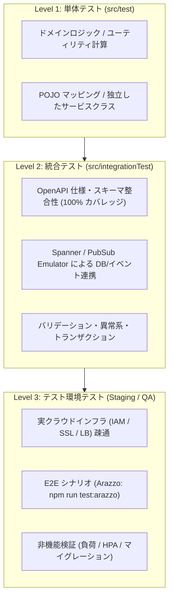
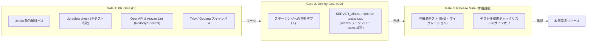

# プロジェクト テスト戦略 (Test Strategy)

本ドキュメントは、本リポジトリ（Kotlin / Spring Boot / Cloud Spanner / Pub/Sub）における品質保証の基本方針、テスト階層（テストピラミッド）、責務の切り分け基準、および CI/CD における品質ゲートを定義する全体戦略です。

---

## 1. 基本方針と原則

本プロジェクトのテスト戦略は、以下の 3 原則に基づきます。

1. **シフトレフト (Shift-Left) の徹底**
   - 仕様違反、バリデーション漏れ、DB制約違反、例外ハンドリングの不具合は、すべてコミット前の CI（`integrationTest`）で 100% 検出できるように自動化し、後工程（ステージング環境や本番）への持ち越しを防ぐ。
2. **OpenAPI / Arazzo 仕様駆動 (Spec-First Quality)**
   - API 仕様書（[`docs/openapi.yaml`](../openapi.yaml)）および E2E ワークフロー仕様（[`docs/workflows/todo-workflows.arazzo.yaml`](../workflows/todo-workflows.arazzo.yaml)）を正本（Single Source of Truth）とし、実装コード・単体/統合テスト・実環境 E2E テスト（Redocly Respect）を完全に同期させる。
3. **環境特性に応じた責務分離**
   - 「ロジック・仕様・スキーマ」はエミュレータ上の自動テストで担保し、「実インフラ・IAM権限・性能・外部連携」はテスト環境で担保する。

---

## 2. テストピラミッドと階層構造



| テスト階層 | 配置場所 | 実行環境 / ツール | 実行時間目安 | 主な責務 |
| :--- | :--- | :--- | :--- | :--- |
| **単体テスト (Unit)** | `src/test/` | CI / ローカル (JUnit 5) | 数秒 | 個々の関数、マッパー、独立したビジネスロジックの正当性 |
| **統合テスト (Integration)** | `src/integrationTest/` | CI (Emulator) | 1〜3分 | OpenAPI 適合性、DB 永続化、Pub/Sub 送受信、異常系・境界値 |
| **実環境 E2E / スモーク (Arazzo)** | `docs/workflows/` | テスト環境 (`npm run test:arazzo`) | 約10〜30秒 | 実インフラ・IAM疎通、認証、一連の業務ライフサイクルの実機貫通 |
| **補完スモーク (Curl)** | `scripts/smoke-test.sh` | テスト環境 (Bash / curl) | 約10秒 | Node.js 非搭載の軽量環境用ヘルスチェック・疎通 |
| **非機能テスト (Non-Functional)** | 負荷・運用スクリプト | テスト環境 (k6 等) | 数十分 | ピークトラフィック耐性、無停止デプロイ、マイグレーション |

---

## 3. 責務とテスト切り分け基準

新しいテストケースを追加する際は、以下のフローチャートに従って実装場所を決定します。

```mermaid
flowchart TD
    Start["新しいテスト要件・シナリオ"] --> Q1{"GCP 実機環境や外部サードパーティ API、\n実際の負荷・UI 操作が必須か？"}
    Q1 -- "No (コードとエミュレータで再現可能)" --> Q2{"Controller/DB/PubSub を跨ぐ結合、\nまたは API スキーマ検証か？"}
    Q2 -- "Yes" --> ActionIntegration["`src/integrationTest` に自動テストとして追加"]
    Q2 -- "No (純粋なロジック・関数)" --> ActionUnit["`src/test` に単体テストとして追加"]
    
    Q1 -- "Yes" --> Q3{"API の一連の呼び出しシナリオや\n実環境疎通（スモーク）か？"}
    Q3 -- "Yes" --> ActionArazzo["`docs/workflows/todo-workflows.arazzo.yaml` に\nArazzo ワークフローとして定義\n(npm run test:arazzo で実行)"]
    Q3 -- "No (負荷・耐障害性・インフラ)" --> ActionStaging["`docs/testing/test-environment-specification.md` の\n非機能検証チェックリストに追加"]
```

---

## 4. テストデータ管理方針

テストの信頼性と再現性を維持するため、環境ごとに以下のデータライフサイクルを適用します。

| 環境 | データ方針 | クリーンアップ / 初期化手法 |
| :--- | :--- | :--- |
| **CI (`integrationTest`)** | **使い捨て・完全独立** | テストケースごとにエミュレータのテーブルを初期化、または独立した ID/トランザクションで実行 |
| **Arazzo E2E (Staging)** | **シナリオ内自己完結** | テスト実行時に一意のユーザー名で登録し、ワークフロー末尾の DELETE ステップで作成リソースをパージ |
| **テスト環境 (Staging 固定)** | **固定シード + プレフィックス** | ・事前検証用の固定ユーザーを保持<br>・動的作成データには `test-staging-[UUID]` を付与し、日次バッチでパージ |
| **パフォーマンステスト** | **本番データマスキング** | 本番 DB のスナップショットから個人情報・機密情報をハッシュ化・置換したデータのみをステージングに反映 |

---

## 5. CI/CD 品質ゲート (Quality Gates)

各パイプラインで自動判定される品質基準です。1 つでも未達の場合は後続フェーズへの進行をブロックします。



---

## 6. 不具合再発防止のフィードバックループ

テスト環境や本番環境でバグ・障害が検出された場合、以下のルールを義務付けます。

1. **バグ再現テストの先行作成**:
   - 修正コードを書く前に、**まずバグを再現する `integrationTest`（または単体テスト）を作成し、RED（失敗）になることを確認**する。
   - 複数 API にまたがるシナリオレベルの不具合の場合は、Arazzo ワークフローに失敗ステップを追加する。
2. **修正と GREEN 化**:
   - 不具合箇所の修正を行い、テストが GREEN（成功）になることを確認する。
3. **再発防止資産化**:
   - 作成したテストコード・ワークフロー定義はリポジトリの恒久的な回帰テスト資産としてマージし、将来のデグレを自動防止する。

---

## 7. 関連仕様書・リンク
- [テスト環境テスト仕様書・管理台帳](test-environment-specification.md)
- [Arazzo E2E ワークフロー仕様](../workflows/todo-workflows.arazzo.yaml)
- [自動スモークテストスクリプト](../../scripts/smoke-test.sh)
- [OpenAPI 仕様書](../openapi.yaml)
- [プロジェクト共通コーディング規約](../../.github/rules/guidelines.md)
