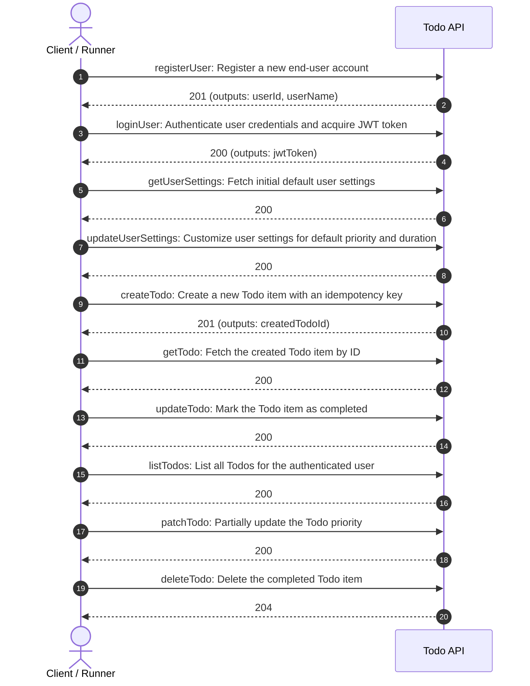
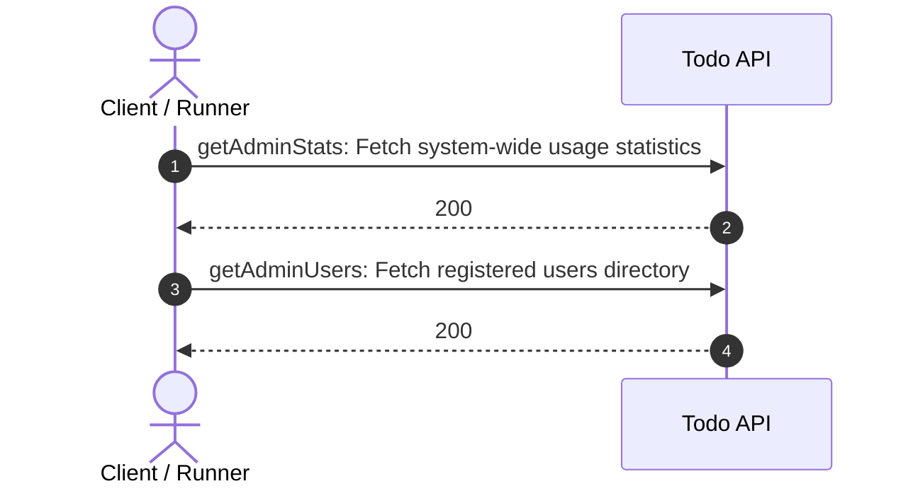

# E2E ワークフロー仕様・可視化ダイアグラム (Arazzo Workflows)

> **自動生成ドキュメント**: 本ドキュメントは `docs/workflows/*.arazzo.yaml` からスクリプト（`npm run generate:diagrams`）により自動生成されています。手動編集は行わず、Arazzo ファイルを直接更新してください。

> **Arazzo UI でのインタラクティブ閲覧**: `npm run arazzo:ui` を実行すると、ブラウザ上でステップ詳細やデータフローをインタラクティブに確認できます。

## Todo API Workflows

End-to-end user workflows and operational journeys for the Todo API.

### ワークフロー: `user-todo-lifecycle`
**User registration, login, and Todo management lifecycle**

Demonstrates registering a new user, authenticating with JWT, inspecting default settings, updating settings, creating an idempotent todo, fetching, updating, listing, and deleting it.

---

### ワークフロー: `admin-audit-lifecycle`
**Administrator system audit**

Inspect system statistics and registered users using administrator API key.

---
