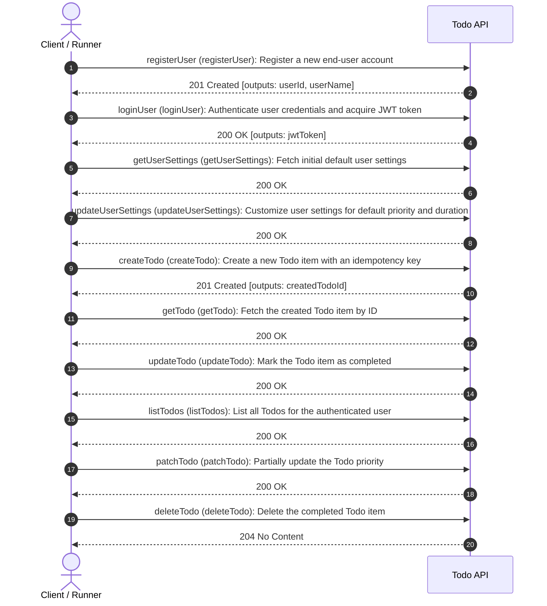
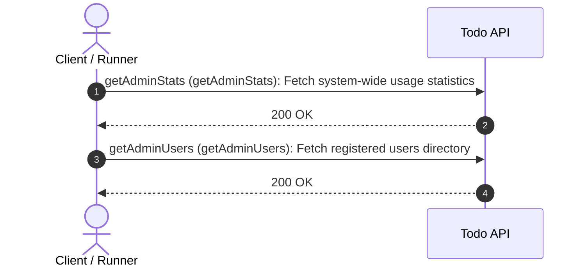
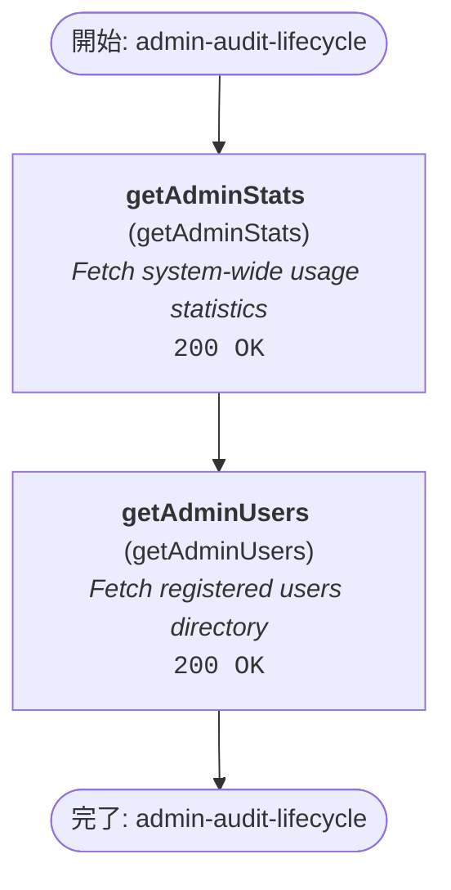

```mermaid
flowchart TD
    Start(["開始: user-todo-lifecycle"])
    Step1["<b>registerUser</b> (registerUser)<br/><i>Register a new end-user account</i><br/><code>201 Created</code>"]
    Start --> Step1
    Step2["<b>loginUser</b> (loginUser)<br/><i>Authenticate user credentials and acquire JWT token</i><br/><code>200 OK</code>"]
    Step1 --> Step2
    Step3["<b>getUserSettings</b> (getUserSettings)<br/><i>Fetch initial default user settings</i><br/><code>200 OK</code>"]
    Step2 --> Step3
    Step4["<b>updateUserSettings</b> (updateUserSettings)<br/><i>Customize user settings for default priority and duration</i><br/><code>200 OK</code>"]
    Step3 --> Step4
    Step5["<b>createTodo</b> (createTodo)<br/><i>Create a new Todo item with an idempotency key</i><br/><code>201 Created</code>"]
    Step4 --> Step5
    Step6["<b>getTodo</b> (getTodo)<br/><i>Fetch the created Todo item by ID</i><br/><code>200 OK</code>"]
    Step5 --> Step6
    Step7["<b>updateTodo</b> (updateTodo)<br/><i>Mark the Todo item as completed</i><br/><code>200 OK</code>"]
    Step6 --> Step7
    Step8["<b>listTodos</b> (listTodos)<br/><i>List all Todos for the authenticated user</i><br/><code>200 OK</code>"]
    Step7 --> Step8
    Step9["<b>patchTodo</b> (patchTodo)<br/><i>Partially update the Todo priority</i><br/><code>200 OK</code>"]
    Step8 --> Step9
    Step10["<b>deleteTodo</b> (deleteTodo)<br/><i>Delete the completed Todo item</i><br/><code>204 No Content</code>"]
    Step9 --> Step10
    End(["完了: user-todo-lifecycle"])
    Step10 --> End
```

# E2E ワークフロー仕様・可視化ダイアグラム (Arazzo Workflows)

> **自動生成ドキュメント**: 本ドキュメントは `docs/workflows/*.arazzo.yaml` からスクリプト（`npm run generate:diagrams`）により自動生成されています。手動編集は行わず、Arazzo ファイルを直接更新してください。

## Todo API Workflows

End-to-end user workflows and operational journeys for the Todo API.

### ワークフロー: `user-todo-lifecycle`
**User registration, login, and Todo management lifecycle**

Demonstrates registering a new user, authenticating with JWT, inspecting default settings, updating settings, creating an idempotent todo, fetching, updating, listing, and deleting it.

#### シーケンス図 (Sequence Diagram)

#### フローチャート (Execution Flowchart)

#### ステップ詳細一覧
| # | Step ID | Operation | 概要 | 期待ステータス | 出力 (Outputs) |
| :-: | :--- | :--- | :--- | :---: | :--- |
| 1 | `registerUser` | `registerUser` | Register a new end-user account | `201 Created` | `userId`, `userName` |
| 2 | `loginUser` | `loginUser` | Authenticate user credentials and acquire JWT token | `200 OK` | `jwtToken` |
| 3 | `getUserSettings` | `getUserSettings` | Fetch initial default user settings | `200 OK` | - |
| 4 | `updateUserSettings` | `updateUserSettings` | Customize user settings for default priority and duration | `200 OK` | - |
| 5 | `createTodo` | `createTodo` | Create a new Todo item with an idempotency key | `201 Created` | `createdTodoId` |
| 6 | `getTodo` | `getTodo` | Fetch the created Todo item by ID | `200 OK` | - |
| 7 | `updateTodo` | `updateTodo` | Mark the Todo item as completed | `200 OK` | - |
| 8 | `listTodos` | `listTodos` | List all Todos for the authenticated user | `200 OK` | - |
| 9 | `patchTodo` | `patchTodo` | Partially update the Todo priority | `200 OK` | - |
| 10 | `deleteTodo` | `deleteTodo` | Delete the completed Todo item | `204 No Content` | - |

---

### ワークフロー: `admin-audit-lifecycle`
**Administrator system audit**

Inspect system statistics and registered users using administrator API key.

#### シーケンス図 (Sequence Diagram)

#### フローチャート (Execution Flowchart)

#### ステップ詳細一覧
| # | Step ID | Operation | 概要 | 期待ステータス | 出力 (Outputs) |
| :-: | :--- | :--- | :--- | :---: | :--- |
| 1 | `getAdminStats` | `getAdminStats` | Fetch system-wide usage statistics | `200 OK` | - |
| 2 | `getAdminUsers` | `getAdminUsers` | Fetch registered users directory | `200 OK` | - |

---
